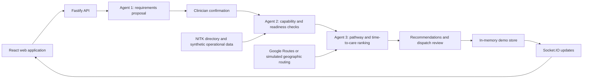

# GoldenHour

**An emergency hospital coordination demo that compares the care a patient needs with the care nearby hospitals can provide?and how soon it can start.**

GoldenHour brings ambulance intake, hospital readiness, routing, destination recommendations and dispatch review into one TypeScript application. Its main regional dataset contains **23 facilities within the configured 40 km NITK Surathkal region**. A separate administrator screen demonstrates the original fictional New York hospitals on a 2D road map.

This project uses synthetic patient and operational data. Hospital names and coordinates come from the supplied dataset; capabilities, staffing, availability and teaching scenarios are not verified live clinical information. It is a demonstration system, not a clinically validated emergency dispatch service.

## What the project demonstrates

The nearest hospital is not always the most suitable destination. A nearby facility may be able to stabilize a patient quickly while a more distant facility provides a required specialist service. A hospital with more equipment may still have a longer wait for the needed theatre or team.

GoldenHour separates these questions:

1. **What does this patient need?** Agent 1 proposes requirements from symptoms and observations.
2. **Which facilities can provide the required care?** Agent 2 checks capabilities, resources and staff.
3. **When could appropriate care begin?** Agent 3 combines travel and readiness information to rank candidates.
4. **What should happen next?** A clinician confirms requirements and a user initiates dispatch or reviews diversion.

Patient severity alone does not determine a destination. Critical specialist cases may still require direct transport to a definitive-care facility. Stabilization-first decisions are represented separately from definitive treatment needs.

## Screens and roles

| Screen | Route | Purpose |
| --- | --- | --- |
| Ambulance terminal | `/` | Enter observations, load patient presets, review Agent 1, confirm requirements, compare destinations, place an origin pin and manage a case |
| Hospital terminal | `/hospital` | Review incoming requests, readiness, resources and hospital workflow |
| Admin dispatch | `/admin` | Inspect fleet, cases, directory, audit information and simulation controls |
| NITK simulation | `/admin?tab=simulation` | Existing 3D simulator for the regional demo |
| New York teaching demo | `/admin/legacy-demo` | Admin-only, isolated 2D simulation with fictional hospitals, moving ambulance, traffic and theatre-readiness controls |

The New York screen runs a local rules demonstration. It does not call the clinical agents, create patient cases or replace the NITK hospital directory.

## Architecture



### Technology choices

| Technology | Use in this repository | Why it fits |
| --- | --- | --- |
| TypeScript | Web, API, contracts and fixtures | Shared types make changes across application boundaries easier to check |
| pnpm workspaces | Four packages under `apps/` and `packages/` | Manages shared dependencies and coordinated scripts in one repository |
| React 18 and React Router | Role-specific screens, forms and navigation | Components share map, recommendation and session behavior |
| Vite and Tailwind CSS | Web development/build tooling and styling | Fast development feedback and consistent UI styling |
| Fastify 5 | HTTP API and request hooks | Modular routes and centralized authentication/validation |
| Zod | Runtime contracts | Validates incoming data beyond TypeScript's compile-time checks |
| Gemini via `@google/genai` | Optional requirements interpretation and coordinator briefing | Helps interpret narrative input; rule-based fallback keeps the demo usable when unavailable |
| Deterministic matching and ranking | Agent 2 and Agent 3 | Makes eligibility, timing and exclusions inspectable and reproducible |
| Google Maps JavaScript API | Browser geographic map | Displays the ambulance, actual dataset locations and route geometry |
| Google Routes API | Optional backend road routing | Supplies route distance, travel time and geometry when configured |
| Simulated routing and SVG | Geographic fallback and 2D teaching visualization | Supports demonstration without requiring live map services |
| Socket.IO | Position and workflow events | Updates connected screens without manual reloads |
| Three.js, React Three Fiber and Drei | Existing NITK 3D simulator | Provides a scene-based visualization of the simulated journey |
| PostgreSQL 16 and `pg` | Migration infrastructure and database health checks | Provides the relational database foundation; current runtime behavior is described below |
| Vitest and Testing Library | API and component regression tests | Exercises requirements, routes, role behavior and user interactions |

**Current storage model:** the active demo uses the process-local store in `apps/api/src/db/store.ts`. PostgreSQL configuration and SQL migrations exist, but a healthy database connection does not mean all application state is persisted there. Restarting the API reseeds the in-memory demo; do not treat it as durable or multi-instance storage.

**RAG status:** vector database/RAG documents describe proposed work. The current implementation does not require a vector database and should not be presented as an implemented vector-backed RAG pipeline.

## Repository layout

```text
apps/
  api/
    src/
      db/                  Demo store, database connection, migrations and seed entry points
      modules/
        agents/            Requirements, eligibility, ranking and coordination
        auth/              Sessions and role checks
        cases/             Assessments and recommendations
        dispatch/          Destination and dispatch workflow
        hospitals/         Directory and resource interfaces
        routing/           Google and simulated routes; shared route snapshots
        scheduling/        Theatre scheduling and priority-review workflow
        simulation/        Origin selection and simulation controls
        realtime/          Socket.IO event delivery
    test/                  API regression suites
  web/
    src/
      components/          Maps, recommendation cards and shared controls
      pages/               Ambulance, hospital, admin and isolated 2D demo
      context/             Authentication and demo role switching
      hooks/               Shared data loading
      lib/                 API client, socket client and local demo rules
      test/                Component tests and canonical NITK test fixtures
packages/
  contracts/src/           Shared DTOs and Zod schemas
  scenario-fixtures/src/   Dataset importer, operational overlays and teaching scenarios
    data/                  Canonical supplied NITK JSON dataset
migrations/                SQL schema migrations
docs/                      Design notes and implementation plans
```

## Run locally

### Prerequisites

- A modern Node.js runtime; use Node.js 22.12+ for the local setup. The source uses ESM and JSON import attributes.
- pnpm with support for the checked-in lockfile and workspace configuration.
- Git.
- Docker is optional for running the supplied PostgreSQL service.

The repository does not currently pin a root `packageManager` version. Keep the lockfile when installing; do not replace it with an npm or Yarn lockfile.

### 1. Install dependencies

Clone your repository URL, enter its root directory, then run:

```sh
pnpm install --frozen-lockfile
```

### 2. Configure environment variables

For a basic local demo, the API defaults to port 4000 and the frontend to port 3000. Gemini and Google APIs are optional.

Copy `.env.example` to `.env` only if a local `.env` does not already exist. In PowerShell:

```powershell
if (-not (Test-Path .env)) { Copy-Item .env.example .env }
```

The checked-in template is minimal. Configure the following as needed:

| Variable | Location | Purpose |
| --- | --- | --- |
| `PORT` or `API_PORT` | Root `.env` or API environment | API port; default `4000`, with `API_PORT` taking precedence |
| `API_HOST` | API environment | Listening interface; default `0.0.0.0` |
| `CORS_ORIGIN` | API environment | Browser origin; default `http://localhost:3000` |
| `DATABASE_URL` | API environment | PostgreSQL connection for migrations and health checks |
| `GEMINI_API_KEY` | API environment | Optional Gemini interpretation/briefing |
| `GOOGLE_MAPS_API_KEY` or `GOOGLE_ROUTES_API_KEY` | API environment | Optional server-side Google Routes credentials; the former is checked first |
| `VITE_GOOGLE_MAPS_API_KEY` | `apps/web/.env` | Browser Maps JavaScript API key |
| `NODE_ENV` | API environment | Development/test/production behavior |

For the optional browser map, create `apps/web/.env` with a placeholder replaced locally:

```dotenv
VITE_GOOGLE_MAPS_API_KEY=your_browser_maps_key
```

Keep server credentials out of `VITE_*` variables: those values are exposed in the browser build. Use a browser key restricted to the intended sites and API. Do not commit real environment files.

The current API client uses relative `/api/...` URLs and the Vite proxy targets `http://localhost:4000`. The `VITE_API_BASE_URL` entry in the existing template is not consumed by that client. If changing the API port, update the proxy configuration too. Restart development servers after environment changes.

### 3. Start the app

```sh
pnpm dev
```

Or run the processes in separate terminals:

```sh
pnpm dev:api
pnpm dev:web
```

Open **http://localhost:3000**. The API is available at **http://localhost:4000**. The API initializes its synthetic store during startup; a separate seed command is not required for the basic demo.

### 4. Optional PostgreSQL setup

```sh
docker compose up -d postgres
pnpm migrate
```

The development Compose file provides PostgreSQL on port 5432. Its supplied credentials match the API's local development default. These are demo credentials, not a deployment configuration.

Health endpoints:

- `/health/live`: API process liveness.
- `/health/ready`: PostgreSQL connectivity; returns `503` when the database is unavailable.
- `/api/v1/health`: combined diagnostic information.

A **DB degraded** indicator can coexist with a functioning in-memory demonstration. Starting PostgreSQL resolves database connectivity, not the runtime persistence limitation.

## Demo accounts

The frontend attempts to restore a session, then defaults to the paramedic demo account if necessary. Use the header's account selector to switch roles in the development demo.

All seeded demo accounts use password **`demo123`**.

| Role | Email |
| --- | --- |
| Paramedic | `paramedic@goldenhour.test` |
| Administrator | `admin@goldenhour.test` |
| A.J. Hospital and Research Centre | `aj_hospital_mangaluru@goldenhour.test` |
| Padmavathi Hospital | `padmavathi_surathkal@goldenhour.test` |

Each current facility has its own hospital account. See [the full hospital login list](docs/current-hospital-demo-logins.md). The demo-account listing endpoint is not available in production mode; do not assume the development role switcher is a production identity system.

## NITK dataset and map behavior

The source is [`nitk_facilities.synthetic.json`](packages/scenario-fixtures/src/data/nitk_facilities.synthetic.json). The importer validates records and creates canonical IDs such as `nitk:AJ_HOSPITAL_MANGALURU`.

- Preserve source hospital names and coordinates. Synthetic readiness belongs in operational overlays, not random relocation of hospitals.
- The configured regional boundary is measured from NITK using straight-line geographic distance; it is not a 40 km driving-distance limit.
- Real map coordinates do not imply verified real-world service availability.
- The authenticated directory supplies map markers. **A/B/C are recommendation roles**, not permanent names assigned to three hospitals.
- Markers update when recommendations change, and the map fits the directory or current recommended facilities into view.
- **Set Pin** creates a draft origin. Validate and confirm it before recalculation uses the new location.
- Pin placement is restricted during active transport. It is an origin setup action, not an in-transit diversion control.
- Confirming a pin clears old recommendation/route displays and requests a new calculation. If refresh fails, the UI reports it rather than retaining an old ranking as current.
- Google road routing is optional. Simulated graph routes and their access connectors are approximations, not validated road-safe navigation.

## Agent and dispatch workflow

### Agent 1: propose requirements

The ambulance crew enters a presenting complaint, urgency, vital signs and support information. Agent 1 proposes definitive-care needs, immediate stabilization needs and patient-state/pathway information. Missing measurements remain unknown rather than being filled with normal values.

Gemini is an optional interpreter. The source currently configures `gemini-3.5-flash-lite`; availability depends on the configured account. When calls fail or exceed quota, the application falls back to its clinical demonstration rules. An optional LLM briefing is an explanation layer, not the authoritative source of hospital resources.

### Clinician confirmation

The review step confirms the requirements and proposed pathway information before destination generation. Loading another preset invalidates the previous displayed assessment and recommendations. A preset describes a patient scenario; it does not guarantee that a named hospital will win or artificially set a theatre to busy.

### Agent 2: evaluate facilities

The evaluator checks the current directory against required capabilities, resource availability, staffing and the relevant intervention. Immediate stabilization and definitive care are different objectives. A nearby facility missing an immediate requirement must not be treated as suitable solely because it is close.

### Agent 3: compare feasible care times

Ranking uses a shared route snapshot and readiness information. The core timing idea is:

```text
Care start = max(travel time, service-ready offset) + intake time
```

Readiness offsets are relative to the evaluation time. Do not add the entire readiness delay again if it overlaps the ambulance journey. Route evidence, eligibility, selected pathway and resource constraints all affect the result.

Deterministic ranking is intentional: it makes a decision reproducible from the same evidence. Agent-oriented coordination comes from gathering and combining evidence, proposing structured requirements and supporting reassessment?not from randomizing winners.

### Dispatch, receipt and diversion

A user initiates dispatch to the appropriate candidate. The hospital workflow handles requests and resource allocation, while events update connected screens. Deterioration opens a diversion review; it must not silently change the destination. Theatre conflicts can produce priority-review tickets for hospital decisions rather than automatically interrupting an operation.

The patient reset button clears the current form and selection for a new case while retaining existing records. It is restricted during active transport and is not a database deletion feature.

## Demonstration walkthrough

### Current NITK workflow

1. Open the ambulance terminal and verify that the directory has loaded.
2. During setup, place and confirm a pin in the supported NITK region, or use **NITK Default**.
3. Select a patient preset and inspect its observations.
4. Run **Agent 1 Requirements Synthesis**.
5. Review the proposed requirements and pathway, then use the clinician confirmation action.
6. Compare the actual recommended facility names, eligibility reasons and times. A/B/C markers should correspond to those same current-directory IDs.
7. Before dispatch, change the pin to demonstrate route-dependent distances and timing. Recompute results need not change the winner if its care suitability still dominates.
8. Dispatch a candidate, then switch to that hospital's account to inspect its request workflow.
9. Use admin views for case state and simulation; use the deterioration review flow to demonstrate a proposed diversion.

### Isolated New York 2D workflow

1. Switch to the administrator account.
2. Open **New York 2D demo** in the header.
3. Compare specialist, general-surgery and stabilization-first pathways.
4. Change simulated traffic or Bayview theatre readiness and inspect the new ranking.
5. Start, pause or reset the ambulance animation. One real second represents one simulated minute.

St. Jude, Bayview and Northpoint are fictional teaching facilities on a schematic map. The screen deliberately remains separate from the NITK API and 3D simulator. Readiness changes can make another eligible facility?including C?win; outcomes are not forced to alternate only between A and B.

## Development commands

| Command | Purpose |
| --- | --- |
| `pnpm dev` | Start API and web development processes |
| `pnpm dev:api` / `pnpm dev:web` | Start one application |
| `pnpm typecheck` | Type-check workspace packages |
| `pnpm build` | Build workspace packages |
| `pnpm test` | Run workspace test suites |
| `pnpm migrate` | Apply database migrations |
| `pnpm seed` | Run the synthetic store seed entry point in a separate process |
| `pnpm reset-demo` | Alias of the seed script; it does not reset an already-running API process |

For a fresh in-memory demo, restart the API. The lint scripts currently contain placeholders and should not be treated as comprehensive lint checks.

Useful focused regression checks:

```sh
pnpm --filter @goldenhour/web test -- src/test/LiveMap.test.tsx src/test/AmbulancePage.test.tsx src/test/LegacyDemoPage.test.tsx
pnpm --filter @goldenhour/api test -- test/hospital-directory-origin-fix.test.ts test/nitk-directory-ranking.test.ts test/patient-state-aware-hospital-selection.test.ts
```

The current map tests derive identities and coordinates from the canonical NITK JSON. Full-directory routing tests cover all supplied facilities. Separate teaching tests may use synthetic fixed travel times to isolate ranking logic; those values are not live-route promises.

Do not infer that the full suite passes from targeted results. Older suites may retain legacy assumptions, and some integration paths can contact configured external services. Record test scope and fallback behavior when reporting results.

## Troubleshooting

| Symptom | Check |
| --- | --- |
| API works but DB says degraded | Start PostgreSQL and verify `DATABASE_URL`; `/health/ready` checks database connectivity separately |
| Google map does not load | Check `apps/web/.env`, browser-key restrictions and API access; restart Vite; the fallback map should remain available |
| Routes show simulated provenance | Check server routing credentials; the browser Maps key alone does not configure server routing |
| Gemini uses rules fallback | Check the API key, account/model access, quota and API logs |
| No hospital markers | Confirm authentication and directory loading; use the directory retry action and Fit All Facilities |
| Old recommendations after changing patient | Run and confirm the new assessment; selecting a preset only fills the patient form |
| Origin pin rejected | Check the 40 km boundary, supported road access, preview expiry and active simulation/dispatch state |
| New York demo inaccessible | Switch to the administrator account; the screen is admin-only |
| Seed command did not reset the running demo | It seeds a separate process; restart the API to reinitialize active in-memory state |
| Frontend cannot reach API | Check port 4000 and the Vite `/api` and `/socket.io` proxies |

## Deployment status and limitations

The local development workflow is the documented entry point. Dockerfiles and `docker-compose.prod.yml` exist, but they are **not a verified production deployment recipe**:

- Dockerfiles currently copy `tsconfig.json`, while the repository's shared configuration is `tsconfig.base.json`.
- Shared package entry points reference source files; the API runtime image copies compiled output. Package resolution and runtime contents need reconciliation.
- Compose contains demonstration credentials and requires a deployment-specific configuration review.
- Browser map credentials need build-time configuration; server route credentials also need explicit container wiring.
- Runtime store/session behavior, durable persistence, multi-instance coordination and production authentication require further work.
- Browser map appearance and 3D behavior need live-browser verification; passing component tests does not establish visual correctness.

Connecting PostgreSQL or enabling Gemini does not remove these limitations.

## Documentation and contributions

Start with these supporting documents, noting that plans can describe work that has not been implemented:

- [Patient-state-aware hospital selection plan](docs/codex-patient-state-aware-hospital-selection-plan.md)
- [NITK dataset rebuild and pin repair plan](docs/nitk-40km-dataset-first-rebuild-and-pin-repair-plan.md)
- [Map and simulator improvement plan](docs/map-simulator-five-stage-improvement-plan.md)
- [Git file review and ignore-policy plan](docs/git-push-file-review-and-gitignore-plan.md)
- [Current hospital demo logins](docs/current-hospital-demo-logins.md)

When contributing, keep shared contracts and their consumers aligned, preserve canonical hospital identities, add focused regression coverage and distinguish synthetic evidence from verified/live data. Commit source, configuration, the lockfile and necessary datasets; exclude real environment files, credentials, dependencies and generated builds. Review the staged diff before publishing.

Generated documents belong in the local `output/` or `out/` folders. Both folders are ignored by Git and should stay out of commits and pushes. The two PDFs previously tracked under `output/pdf/` have been removed from Git's index; this does not delete the local copies. Keep editable source documentation in `docs/` when it needs to be shared with the repository.
