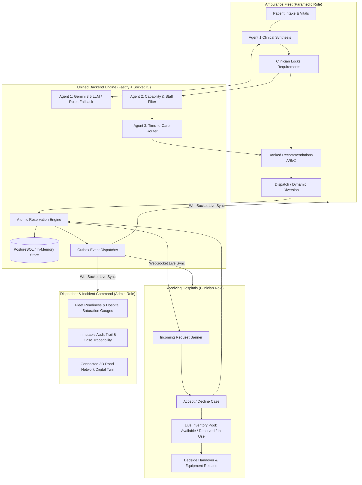

# GoldenHour — Emergency Hospital Coordination Platform

> **Hackathon Demonstration & Clinical Digital Twin**  
> **Status:** All 13 Phases Fully Completed and Verified  
> **Safety Notice:** Synthetic patient data and simulated hospital environments only. Not clinically validated for real-world medical diagnosis or autonomous emergency dispatch.

---

## 1. System Architecture & Component Model

GoldenHour coordinates in-transit ambulance crews with regional trauma centers and community emergency departments. The system provides real-time telemetry ingestion, clinical AI assistance (Agent 1), dynamic capability filtering (Agent 2), time-to-care routing ranking (Agent 3), atomic hospital equipment reservations, live dynamic diversions, and an integrated 3D digital twin.



---

## 2. Invariant Rules Strictly Preserved

1. **Available Inventory Formula:**
   $$\text{Available} = \text{Total} - \text{Out of Service} - \text{External In-Use} - \text{Reserved} - \text{In-Use}$$
2. **Standby Tickets Never Lock Equipment:** Only confirmed acceptance of Destination A triggers atomic equipment reservation. Standby B/C tickets receive real-time situational awareness notices without locking scarce resources.
3. **Atomic Contention Rollback:** All required hospital resources (e.g. Trauma Bay, Neuro OR, Ventilator, ICU Bed) succeed together in a single transaction or none succeed (all-or-nothing rollback).
4. **Dynamic Diversion with Clean Release:** Diverting to Backup B immediately and atomically releases unused equipment reservations at Hospital A.
5. **Separation of Arrival and Equipment Release:** Patient arrival moves resources from `Reserved` $\rightarrow$ `In Use`. Bedside handover does not prematurely release equipment; explicit hospital release marks equipment available once decontamination/sterilization is complete.
6. **Clinician Confirmation Gate:** AI models (Gemini 3.5 LLM) only formulate proposals; human clinicians must review and confirm all clinical requirements before dispatch.
7. **Transparent Live vs Simulated Indicators:** External routing engines (`LIVE_OSRM`) and simulated road graphs (`SIMULATED_GRAPH`) are explicitly distinguished and never mislabeled.

---

## 3. Quick Start & Running Locally

### Prerequisites
- **Node.js**: `v20.0.0` or higher
- **pnpm**: `v9.0.0` or higher (`npm install -g pnpm`)
- **Git**

### Installation
```bash
# Clone and install dependencies
git clone <repo-url>
cd "golden hour 2"
pnpm install
```

### Environment Configuration
The project is preconfigured with `.env` and `apps/api/.env`.
```env
PORT=4000
NODE_ENV=development
JWT_SECRET=super-secret-golden-hour-jwt-key-for-dev-only
CORS_ORIGIN=http://localhost:3000
GEMINI_API_KEY=your-gemini-api-key-here
```

### Running the Application
```bash
# Start both Backend API (:4000) and Web Frontend (:3000) concurrently:
pnpm dev
```
Or run individually:
- **Terminal 1 (Backend Fastify API & Socket.IO):** `pnpm dev:api` (accessible at `http://localhost:4000`)
- **Terminal 2 (Frontend Client):** `pnpm dev:web` (accessible at `http://localhost:3000`)

---

## 4. Production Deployment & Docker Compose

GoldenHour includes multi-stage production Dockerfiles and an orchestrated `docker-compose.prod.yml` configuration:

```bash
# Launch production stack (PostgreSQL + API + Nginx Web Reverse Proxy):
docker compose -f docker-compose.prod.yml up -d --build
```

### Service Map:
- **Web & Reverse Proxy:** `http://localhost:3000` (Nginx serving SPA and proxying `/api` and `/socket.io` with WebSocket upgrades)
- **API Server:** `http://localhost:4000`
- **PostgreSQL Database:** `localhost:5432`

---

## 5. Demo Accounts & Role Switching

Users can log in with the following seeded accounts or use the persistent **"Switch Role"** pill in the top navigation bar:

| Role | Entity / Facility | Email | Password |
|---|---|---|---|
| **Paramedic** | Ambulance Fleet (Medic 4) | `paramedic@goldenhour.test` | `demo123` |
| **Hospital Clinician** | A.J. Hospital and Research Centre | `aj_hospital_mangaluru@goldenhour.test` | `demo123` |
| **Hospital Clinician** | Padmavathi Hospital | `padmavathi_surathkal@goldenhour.test` | `demo123` |
| **System Dispatcher** | Regional Command / Admin | `admin@goldenhour.test` | `demo123` |

All 23 supplied facilities have separate demo accounts. Select a facility in the header or see [the current hospital login list](docs/current-hospital-demo-logins.md). Names and coordinates come from the supplied NITK dataset; operational capacity is synthetic.


---

## 6. Hackathon Presentation Walkthrough Script

Follow these 7 steps to showcase the full clinical emergency lifecycle:

1. **Step 1: Patient Ingestion & AI Synthesis (Paramedic View)**
   - Open `http://localhost:3000` logged in as `paramedic@goldenhour.test`.
   - Select the preset **"Polytrauma + TBI"** (GCS 8, BP 82/50, SpO2 88%).
   - Click **"Run Agent 1 Assessment"**.
   - Notice the purple **Gemini 3.5 AI Model** badge. Gemini identifies severe neurological depression and respiratory failure, mandating Trauma L1, Neurosurgery, and Ventilator.
   - Click **"Confirm Clinical Requirements"** to lock assessment version 1.

2. **Step 2: Intelligent Routing & Real-Time Ranking (Agents 2 & 3)**
   - View the recommendation cards. **St. Jude Trauma** is ranked #1 (Full Care Eligible, lowest time-to-care).
   - **Bayview Community** is visible as Dynamic Backup B for proximity stabilization.
   - Click **"Dispatch to St. Jude"**.

3. **Step 3: Hospital Receipt & Atomic Equipment Reservation (Hospital View)**
   - Switch role to `aj_hospital_mangaluru@goldenhour.test`.
   - In the incoming emergency request banner, click **"Accept Case"**.
   - Watch the inventory pools immediately update: Trauma Bay, Neuro OR, and ICU Bed transition from `Available` $\rightarrow$ `Reserved`.

4. **Step 4: Connected 3D Digital Twin Simulation (Admin View)**
   - Switch role to `admin@goldenhour.test` and open the **3D Simulation** tab.
   - Click **"Play"** to watch the ambulance navigate along the road network towards St. Jude in real time.
   - Click **"Inject Traffic Surge"** to simulate an expressway congestion spike; observe dynamic ETA recalculations.

5. **Step 5: Dynamic In-Transit Diversion**
   - Switch back to the Ambulance screen. The patient decompensates in transit.
   - Click **"Divert to Bayview Community"**.
   - St. Jude's reserved equipment is immediately and atomically unlocked back to `Available`.
   - Bayview receives the primary assignment and reserves its stabilization resources.

6. **Step 6: Arrival, Bedside Handover, and Equipment Release**
   - Click **"Mark Arrived"** $\rightarrow$ resources move from `Reserved` $\rightarrow$ `In Use`.
   - Click **"Complete Handover"** $\rightarrow$ case transitions to `HANDED_OVER`.
   - In the hospital terminal, click **"Release Equipment"** once decontamination finishes $\rightarrow$ resource counts return to `Available`.

7. **Step 7: Dispatcher Audit Timeline**
   - Switch to the Admin view.
   - Select the case in the Active Cases table.
   - Review the **Immutable Audit Trail** demonstrating full traceability for every clinical transition, routing evaluation, and resource reservation.

---

## 7. Verification & Quality Gate

Run full verification suite at any time:

```bash
# Run all unit, integration, and E2E test suites:
pnpm test

# Run TypeScript typechecks across all 4 monorepo packages:
pnpm typecheck

# Build all packages and applications for production:
pnpm build
```

- **API Test Suites:** 11 passed (65 tests)
- **Web Test Suites:** 8 passed (19 tests)
- **Total Passing Tests:** 84 tests (0 failures)
